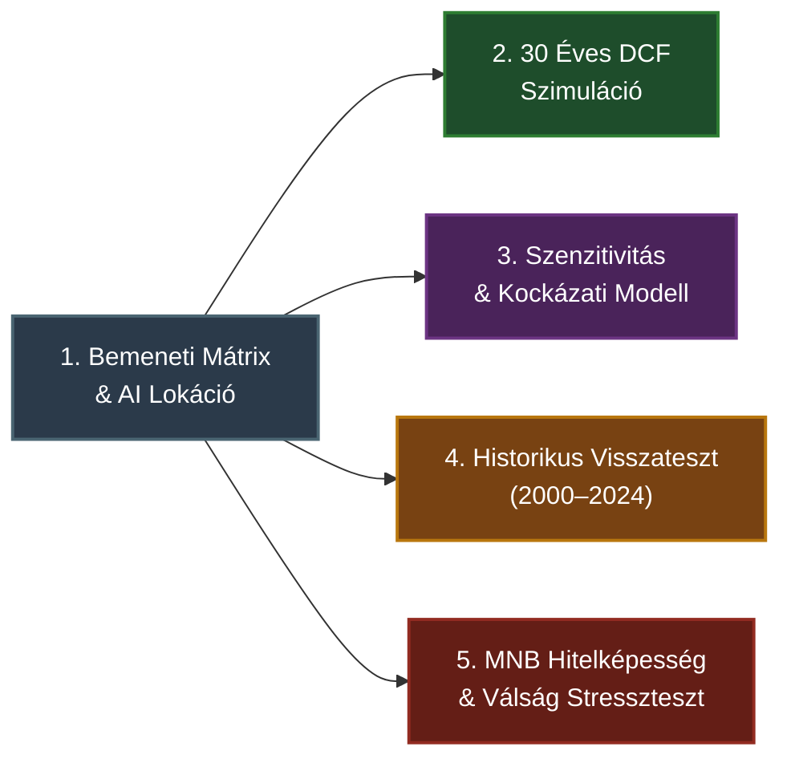

<div align="center">
  <h1>🏡 Saját Lakás vs. Albérlet Kalkulátor & Pénzügyi Szimulációs Rendszer</h1>
  <p><strong>Advanced Quantitative Real Estate, Macro-Prudential & Financial Simulation Platform for the Hungarian Market</strong></p>
  <p><em>Budapesti Műszaki és Gazdaságtudományi Egyetem (BME GTK) – Projektfeladat</em></p>

  [](https://www.python.org/)
  [](https://flask.palletsprojects.com/)
  [](https://pytest-cov.readthedocs.io/)
  [](https://docs.pytest.org/)
  [](https://getbootstrap.com/)
  [](https://ai.google.dev/)
  [](LICENSE)
</div>

---

## 📖 Áttekintés (Project Overview)

Ez a projekt egy professzionális, interaktív kvantitatív pénzügyi és ingatlanpiaci szimulációs keretrendszer, amely a modern **Flask** mikroweb-keretrendszerre, vektorizált **NumPy** számítási motorra, valamint modern interaktív **JavaScript (Chart.js)** frontend architektúrára épül.

A platform célja a magyar gazdasági és jogi sajátosságok (pl. **TBSZ** adómentesség, **15% SZJA**, **vagyonszerzési illeték**, **ügyvédi munkadíj**, **CSOK Plusz** illetékmentesség, **32/2014. MNB JTM** adósságfék-szabályozás) figyelembevételével objektív, 30 éves diszkontált cash-flow (DCF) és historikus visszatesztelt (2000–2024) összehasonlítást adni a **saját lakás vásárlása**, az **albérletben élés melletti tőkepiaci (ETF) befektetés**, valamint a **befektetési célú lakásvásárlás (Buy-to-Let)** között.

A rendszer szerves részét képezi a legújabb **Google GenAI SDK-val** integrált mesterséges intelligencia réteg (**Gemini 3.5 Flash Lite** és **Gemini 3.8 Flash**), amely nem csupán szöveges elemzést és mikrolokációs pontozást végez, hanem képes kétirányú természetes nyelvű párbeszédben közvetlenül módosítani a dashboard csúszkáit és bemeneti paramétereit is.

---

## 🏛️ Rendszerarchitektúra & Az 5 Fő Modul (5-Tab Experience)

A platform 5 különálló, egymással szinkronizált analitikai lapra tagolódik:



### 1. 🎛️ Bemeneti Paraméterek (Interactive Matrix & AI Location)
* **Kvantitatív ingatlan-, hitel- és bérleti adatkezelés:** Valós idejű input-szinkronizáció, perzisztens helyi mentés és visszaállítás (`/api/inputs`).
* **Algoritmikus javaslattevő motor:** Város, kerület, szobaszám és energetikai besorolás alapján kalkulál becsült négyzetméterárat, reális bérleti díjat, rezsit és berendezési költséget.
* **AI Mikrolokációs Elemző (`/api/analyze_location`):** Pontos utcacím alapján értékeli a környék infrastruktúráját, közlekedését és bérbeadhatóságát.
* **AI Notes Evaluator:** Szöveges megjegyzésekből (pl. *„Dunai panoráma, felújítandó fürdőszoba”*) számszerű százalékos korrekciókat képez szigorú sémával és biztonsági fallback réteggel.
* **Interaktív AI Chat Asszisztens (`/api/chat`):** Természetes nyelvű instrukciók alapján (pl. *„Vegyük le az önerőt 15.000.000 Ft-ra és emeljük a kamatot 7%-ra”*) képes a dashboard paramétereit valós időben felülírni.

### 2. 📊 Szimulációs Eredmények (30-Year DCF Simulation Engine)
* **Háromirányú vagyonelemzés:**
  1. **Saját Lakás (Owner-Occupied):** Francia annuitásos törlesztés, amortizáció, közös költség, felújítási alap, valamint a tőketörlesztés után fennmaradó jövedelem tőkepiaci befektetése.
  2. **Bérlés & ETF Portfólió (Rent & Invest):** A vásárláshoz szükséges teljes kezdőtőke (önerő + vagyonszerzési illeték + ügyvédi munkadíj + berendezés) és a havi megtakarítás befektetése adómentes **TBSZ** számlán.
  3. **Befektetési Célú Vásárlás (Buy-to-Let / BTL):** Tiszta befektetési szemszög – bérleti díjbevétel, 15%-os SZJA (10%-os költséghányad mellett 13,5% effektív adóteher), a keletkező nettó cash-flow azonnali ETF-újrabefektetésével.
* **Kvantitatív metrikák:** ROE (Return on Equity), LTV lefutási görbe, bruttó/nettó bérleti hozam, Price-to-Rent ráta, Diszkontált Cash-Flow (DCF) és Nettó Jelenérték (NPV).
* **Break-Even Point (Fordulópont):** Dinamikus havi szintű fordulópont-keresés, megmutatva azt a pontot, ahol a saját lakás nettó vagyona tartósan megelőzi a bérlői portfóliót.
* **„Holt pénz” (Dead Money) analízis:** Interaktív fánkdiagramokon hasonlítja össze a vissza nem térülő költségeket: banki kamatkiadások, amortizáció, illeték, ügyvédi díj vs. kifizetett lakbér.

### 3. 🎲 Szcenárióelemzés & Kockázati Modell (Sensitivity Matrix & Scenarios)
* **2D Szenzitivitási Hőtérkép (Heatmap):** Az ingatlan árnövekedési üteme és az alternatív tőkepiaci hozam (S&P 500 / All-World) mátrixában mutatja meg a 30 év múlva optimális stratégiát.
* **Piaci forgatókönyvek összehasonlítása:**
  * *Alapeset (Base Case)*: 50% valószínűség, kiegyensúlyozott növekedés.
  * *Pesszimista / Magas kamatkörnyezet (Bear Case)*: 20% valószínűség, 8,5%-os kamat, mérsékelt ingatlanár-növekedés.
  * *Ingatlanpiaci konjunktúra (Bull Case)*: 20% valószínűség, 9%-os árnövekedés, olcsóbb hitelezés.
  * *Tőkepiaci szárnyalás (Tech Surge)*: 10% valószínűség, kiemelkedő részvénypiaci hozamok.

### 4. 📈 Historikus Eredmények (2000–2024 Backtest & Rolling Windows)
* **Tényleges adatokon alapuló visszateszt:** 2000 és 2024 közötti MNB lakásárindexek, KSH infláció (CPI), BUBOR kamatok és forintosított S&P 500 Total Return index.
* **Kerületi szintű Budapesti és vidéki bontás:** Helyi árindexek leképezése, intelligens ékezetfüggetlen kerületfeloldás (`normalize_location`).
* **Rolling Windows befektetési időszelet-analízis:** Tetszőleges 5, 10 vagy 15 éves tartási periódusok automatikus szimulációja az elmúlt negyedszázad minden lehetséges induló évével.
* **Belső Megtérülési Ráta (IRR):** Pontos évesített hozam számítás Newton-Raphson numerikus módszerrel és bisection fallback algoritmussal.
* **Devizaárfolyam-fedezés (FX Hedge opció):** Lehetőség van a tőkepiaci hozamokat árfolyamhatással (USD/HUF) vagy tiszta fedezett formában elemezni.

### 5. 🛡️ MNB Hitelképesség & Történelmi Válság Stresszteszt
* **MNB JTM (Jövedelemarányos Törlesztőrészlet) Szabályozás:**
  * A **32/2014. (IX. 10.) MNB rendelet** szerinti sávos vizsgálat: `600.000 Ft` nettó jövedelmi határ.
  * Kamatperiódus szerinti JTM limitek: 25%–30% (változó / 5 év alatti), 35%–40% (5–10 év közötti), 50%–60% (legalább 10 évig fix vagy végig fix).
  * Folyószámla- és hitelkártyakeretek jogszabályi 5%-os havi adósságszolgálati terhének automatikus kalkulációja.
* **Adósságfék & HFM (Hitelfedezeti Mutató / LTV):**
  * Általános 80%-os LTV plafon (20% minimális önerő).
  * 2024. január 1-től hatályos **10%-os első lakásvásárlói önerő szabály** (90% LTV).
  * Zöld Hitel kedvezmény (AA+ energetikai tanúsítvány esetén -0,5% kamatkedvezmény).
* **Történelmi Válság Stresszteszt Motor (Crisis Replay Engine):**
  * **2008 Lehman-krízis & Ingatlanpiaci Összeomlás (10 év):** Likviditási sokk, kezdeti -38%-os tőkepiaci és -15%-os kumulált lakásáresés, kamatugrás változó hiteleknél.
  * **2020 Covid-19 Karantén & Albérletpiaci Sokk (5 év):** Az Airbnb leállása és digitális oktatás miatti azonnali -18%-os bérletidíj-zuhanás, bérlői megtakarítási ugrás, gyors V-alakú részvénypiaci felpattanás.
  * **2022–2023 Stagflációs & Kamat / Energia Sokk (5 év):** 25%-os inflációs csúcs, 40%-os rezsiugrás, kamatsokkok és fix vs. változó törlesztési összehasonlítás.

---

## 🧮 Kvantitatív Módszertan & Képletek

### 1. Francia Annuitásos Havi Törlesztőrészlet (PMT)
A havi törlesztés képlete $P_0$ hitelösszeg, $r_m = \frac{r_{éves}}{12}$ havi kamatláb és $n = \text{évek} \times 12$ futamidő esetén:

$$PMT = P_0 \cdot \frac{r_m (1 + r_m)^n}{(1 + r_m)^n - 1}$$

### 2. Bérlői Tőkepiaci Portfólió Felhalmozás (TBSZ mellett)
A bérlő induló vagyona a vásárláshoz szükséges teljes tőkeszükséglet:

$$W_0 = \text{Önerő} + \text{Illeték} + \text{Ügyvéd} + \text{Berendezés/Felújítás}$$

A havi egyenleg alakulása az alternatív hozamráta ($r_{opp, m}$) és a havi többletmegtakarítás ($S_m$) mellett:

$$W_m = W_{m-1} \cdot (1 + r_{opp, m}) + S_m$$

*(Ahol TBSZ hiányában a hozamra a 15%-os SZJA levonásra kerül.)*

### 3. Holt Pénz (Unrecoverable Costs) Képlet
* **Saját lakás esetén:** $\sum (\text{Kifizetett hitelkamat} + \text{Karbantartás/Amortizáció} + \text{Illeték} + \text{Ügyvédi díj})$
* **Bérlés esetén:** $\sum (\text{Kifizetett bérleti díj})$

---

## 🔌 REST API Dokumentáció

| Metódus | Végpont | Leírás |
| :--- | :--- | :--- |
| `GET` | `/api/inputs` | Visszaadja a tárolt vagy alapértelmezett bemeneti paramétereket. |
| `POST` | `/api/inputs` | Elmenti az adatokat és meghívja a Gemini AI szövegelemzőt. |
| `DELETE` | `/api/inputs` | Törli a mentett adatokat, visszaállítja az alapértékeket. |
| `POST` | `/api/calculate` | Fő kalkulációs végpont: 30 éves DCF, metrikák, javaslatok, hőtérkép. |
| `POST` | `/api/historical_simulation` | Historikus backtest tetszőleges kezdőévtől (2000–2024) napjainkig. |
| `POST` | `/api/historical_rolling_windows` | 5, 10, 15 éves gördülő befektetési időszeletek és IRR számítás. |
| `POST` | `/api/creditworthiness` | MNB JTM, maximális hitelösszeg, LTV és adósságfék ellenőrzés. |
| `POST` | `/api/crisis_replay` | Történelmi krízis stresszteszt (2008 Lehman, 2020 Covid, 2022 Stagfláció). |
| `POST` | `/api/analyze_location` | Gemini AI mikrolokációs elemzés adott cím alapján. |
| `POST` | `/api/chat` | AI Pénzügyi Asszisztens chat és interaktív csúszka-módosítás. |
| `POST` | `/api/generate_summary` | Gemini AI vezetői összefoglaló generálása az eredményekből. |
| `POST` | `/api/v1/simulate` | Pydantic-validált v1 API szimulációs végpont. |
| `POST` | `/api/v1/sensitivity` | Pydantic-validált v1 API érzékenységvizsgálati végpont. |

---

## 📁 Projekt Struktúra

```text
calc_flask/
├── api/                             # Moduláris REST API végpontok
│   ├── v1/
│   │   ├── __init__.py
│   │   └── endpoints.py             # Pydantic-validált v1 végpontok
│   └── __init__.py
├── core/                            # Szimulációs, pénzügyi és AI motorok
│   ├── creditworthiness.py          # MNB JTM és hitelképességi kalkulátor (32/2014. rendelet)
│   ├── crisis_replay.py             # Történelmi válság stresszteszt (2008, 2020, 2022)
│   ├── defaults.py                  # Budapesti VIII. kerületi referenciaadatok & szcenáriók
│   ├── engine.py                    # 30 éves DCF és vagyonfelhalmozási szimulációs motor
│   ├── gemini_service.py            # Google Gemini AI integráció & robusztus hibajavító parser
│   ├── historical_engine.py         # 2000–2024 backtest és rolling windows motor (IRR)
│   ├── logger.py                    # Rendszerszintű naplózás
│   └── __init__.py
├── data/                            # Helyi historikus és referencia adatbázisok
│   ├── default_inputs.json          # Alapértelmezett bemeneti profil
│   ├── district_coords.json         # Kerületi koordináták lokációs elemzéshez
│   ├── financial_market_data.json   # S&P 500, USD/HUF, BUBOR idősorok (2000–2024)
│   ├── macro_index.json             # Infláció (CPI) és makrogazdasági adatok
│   ├── real_estate_index.json       # MNB / KSH kerületi lakásárindexek
│   └── saved_inputs.json            # Felhasználó által elmentett egyedi paraméterek
├── schemas/                         # Pydantic adatmodellek & sémák
│   └── simulation.py
├── static/                          # Statikus webes eszközök
│   ├── css/
│   │   └── style.css                # Egyedi Bootstrap kiegészítések és témák
│   └── js/
│       └── app.js                   # Frontend vezérlő (Chart.js, 5 tab, real-time sync)
├── templates/
│   └── index.html                   # Jinja2 dashboard nézet (5 különálló fül, modális ablakok)
├── tests/                           # Átfogó automatizált tesztcsomag (87% lefedettség)
│   ├── test_algorithms_extended.py
│   ├── test_api.py
│   ├── test_app_coverage.py
│   ├── test_coverage_gap.py
│   ├── test_creditworthiness_and_crisis.py
│   ├── test_endpoints.py
│   ├── test_engine.py
│   ├── test_gemini_service.py
│   ├── test_historical_engine.py
│   ├── test_new_features.py
│   └── test_utils.py
├── utils/                           # Kvantitatív és pénzügyi segédfüggvények
│   ├── algorithms.py                # Ingatlanpiaci és rezsibecslő algoritmusok
│   ├── config.py
│   ├── fetch_historical_data.py     # Historikus adatelőkészítő segédprogram
│   ├── finance.py                   # Annuitás, LTV, induló költségek, hozamszámítások
│   ├── formatters.py                # Magyar pénzügyi formázás (pl. 80.600.000 Ft)
│   └── __init__.py
├── app.py                           # Flask alkalmazás belépési pont & fő API réteg
├── pytest.ini                       # Pytest konfigurációs fájl
├── requirements.txt                 # Python függőségek jegyzéke
└── README.md                        # Részletes dokumentáció
```

---

## 🧪 Tesztelés és Minőségbiztosítás (87% Test Coverage)

A projekt átfogó, 68 tesztes automatizált tesztcsomaggal rendelkezik, amely az összes pénzügyi formulát, válságszimulációt, hitelképességi határértéket, REST API végpontot és AI hibakezelési forgatókönyvet vizsgálja.

### Tesztek futtatása:
```bash
# Összes teszt futtatása
pytest

# Tesztek futtatása részletes kimenettel és lefedettségi riporttal
pytest -v --cov=core --cov=utils --cov=api --cov=app
```

### Lefedettségi Riport (Coverage Breakdown):
| Modul | Sorok száma | Kihagyott | Lefedettség |
| :--- | :---: | :---: | :---: |
| `core/defaults.py` | 2 | 0 | **100%** |
| `core/engine.py` | 210 | 6 | **97%** |
| `core/historical_engine.py` | 327 | 17 | **95%** |
| `core/crisis_replay.py` | 106 | 7 | **93%** |
| `core/creditworthiness.py` | 105 | 12 | **89%** |
| `core/logger.py` | 27 | 5 | **81%** |
| `core/gemini_service.py` | 187 | 53 | **72%** |
| `utils/formatters.py` | 36 | 2 | **94%** |
| `utils/finance.py` | 70 | 5 | **93%** |
| `utils/algorithms.py` | 155 | 13 | **92%** |
| `app.py` | 257 | 22 | **91%** |
| `api/v1/endpoints.py` | 42 | 4 | **90%** |
| **Összesen (Total)** | **1592** | **203** | **87%** |

---

## 🚀 Telepítés és Futtatás (Getting Started)

### Előfeltételek
* **Python 3.9+** (Ajánlott: Python 3.11, 3.12 vagy 3.13)
* [Google AI Studio Gemini API kulcs](https://aistudio.google.com/) az AI funkciókhoz

### 1. Repository klónozása
```bash
git clone https://github.com/yourusername/calc_flask.git
cd calc_flask
```

### 2. Virtuális környezet létrehozása és aktiválása
```bash
# Virtuális környezet létrehozása
python -m venv venv

# Aktiválás Windows rendszeren (PowerShell):
.\venv\Scripts\Activate.ps1

# Aktiválás Linux / macOS rendszeren:
source venv/bin/activate
```

### 3. Függőségek telepítése
```bash
pip install -r requirements.txt
```

### 4. Környezeti változók beállítása (.env)
Hozzon létre egy `.env` fájlt a gyökérkönyvtárban:
```env
GEMINI_API_KEY=az_on_gemini_api_kulcsa
FLASK_DEBUG=1
```
*(Megjegyzés: Ha nem áll rendelkezésre Gemini API kulcs, a rendszer az intelligens beépített heurisztikus és lokális algoritmusokra támaszkodik, a szimulációs és pénzügyi modulok zavartalanul működnek.)*

### 5. Az alkalmazás indítása
```bash
python app.py
```
Ezután nyissa meg a böngészőjében a `http://127.0.0.1:5000` címet.

---

## 💰 Pénzügyi Szabványok és Formázás

A rendszer a magyar pénzügyi és számviteli szabványoknak megfelelően a forint összegeket pontozott tagolással jeleníti meg minden rétegben:
* Például: `80.600.000 Ft`, `120.000 Ft`, `600.000 Ft`, `2.500.000 Ft`.

---

## 📜 Licenc

A projekt a nyílt forráskódú **MIT Licenc** alatt érhető el. Lásd a [LICENSE](LICENSE) fájlt a részletekért.
